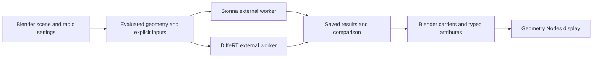

# Project structure

```text
src/differt_bridge/       Shipped Blender extension and external-worker adapters
  assets/                Versioned Geometry Nodes library
  *_blender.py           Blender operators, panels and result integration
  *_worker.py            External-process entry points
tests/                   Portable engine, geometry, export and research tests
  blender/               Built-extension checks executed by Blender itself
  fixtures/              Reviewed Geometry Nodes contract
  tooling/               Developer-tool validation
tools/                   Shared developer commands and project checks
research/                Study catalog, scope and reproduction status
scripts/                 Established numerical runners and report generators
docs/                    User, developer and scientific documentation
examples/                Small committed example inputs
.github/                 Continuous checks and contribution templates
dist/                    Generated extension archives (ignored)
runs/                    Generated tests, profiles and receipts (ignored)
```

## Data flow



The extension owns scene export and visualization. Scientific dependencies
belong to separate external interpreters. Results carry conventions, settings
and matching diagnostics; a visualization is not an independent physics test.

`differt_backend.py`, `precise_visibility.py`, `validated_diffraction.py` and
`segment_policy.py` adapt the external DiffeRT worker. The `*_blender.py`
modules integrate comparison, benchmarks, materials and ISAC into Blender.
`__init__.py` still contains substantial legacy lifecycle, scene and operator
code. The new developer structure does not pretend that this has already been
fully modularized.

## Stable boundaries

- The extension manifest remains the canonical package file list. Development
  tools, research solvers and the new test fixtures are not shipped in the ZIP.
- Existing `scripts/` paths and scientific source bytes are preserved by this
  organizational change. Historical archives refer to their hashes.
- Existing inherited tests stay under `src/differt_bridge/tests/` for compatibility;
  new development tooling and Blender integration checks live under root `tests/`.
- The optional Maxwell companion is separately identified in research. Its
  shared output does not establish agreement between native ray tracers.

Future extraction from the large extension initializer should preserve the
public operators, saved properties and node interface, with tests for the
affected workflow before and after each move.
