# Project archive, results and animations

The [project release](https://github.com/fribas001/differt-bridge/releases/tag/project-2026-11-11) groups source, pinned Windows runtimes, historical reports, scientific inputs/checkpoints, Blender scenes and all 19 comparison videos. Large files are release assets so a normal Git clone stays small.

The [publication receipt](../validation/project-publication.json) records the
published release, verified GitHub hashes and sizes for all 490 transport assets,
and independent public downloads of the manifest, downloader and a 64 KiB
prefix of a data part. The prefix supplements the whole-asset GitHub checksums.

The [recovery validation](../validation/project-archive.json) records 41,375
preserved result files, 30,172 matching restored scientific files, six import-only
profile checks and three Blender dispatch checks. Fourteen static tests passed.
No additional scientific simulations were run. Blender's recovered output folders
are relocated into `local/runs` to protect archived reference data.

## Recover on another computer

The [asset manifest](../reproduction/project/assets.json) pins every download's
SHA-256 and size, and records the source commit carried by `project-source.zip`.

Download `fetch.py` and `assets.json` from the release into one folder. With
Python 3.12 or later, run the following command there. The downloader joins
numbered release parts into the original four ZIPs, verifies every part and each
whole archive, then extracts into a fresh directory. Keep at least 10 GiB free.
Add `--historical` to also download the optional RT 2.1 kit; restore it separately.

```powershell
python .\fetch.py --destination C:\rt-replay --extract
Set-Location C:\rt-replay
.\Replay.cmd verify
.\Replay.cmd setup
.\Replay.cmd probe --profile native
.\Replay.cmd probe --profile phase
.\Replay.cmd probe --profile reciprocal
```

The parts preserve the exact checksums of the tested recovery archives. Completed
downloads are reused on restart. Seven additional transport tests cover joining,
corruption rejection and unsafe names; the original fourteen recovery tests also
pass. The source ZIP freezes commit `be1f6ab`; the branch adds the download manifest,
transport helper and publication records without changing the scientific code.

Open `workspace/index.html` for the full report navigation. For Blender, install/use Blender 5.2.3 and follow the [recovery launcher instructions](../reproduction/project/README.md). The exact two add-ons are included; recovered workers use isolated external interpreters.

Setup/import/dispatch validation does not rerun scientific simulations. The archived numerical comparisons retain their original provenance and tolerances. Different CPUs can change floating-point results. The six previously documented archived-replay differences and the Maxwell model/reference limitations remain disclosed in the study reports.

## Animation gallery

Each video records its own stage of the investigation. Earlier videos are historical checkpoints; improvements to a shared full-wave companion must not be interpreted as improvements to native ray-tracer accuracy. The final specular comparison and latest Maxwell-reference study are useful starting points.

### Initial paths, coverage, motion and phase overview

[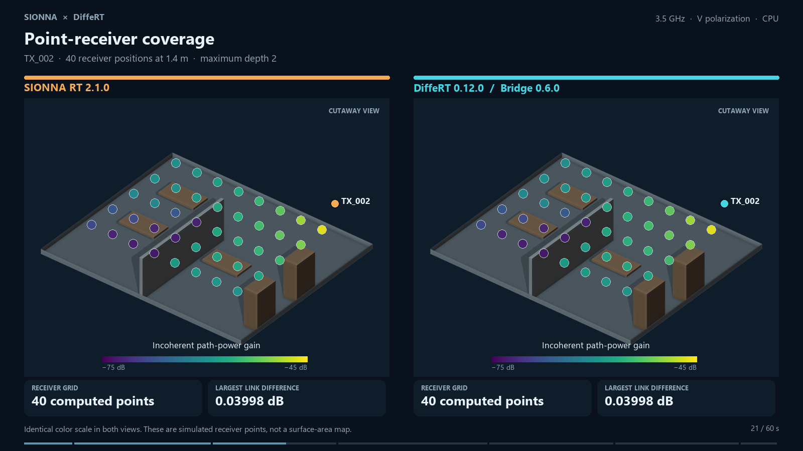](https://github.com/fribas001/differt-bridge/releases/download/project-2026-11-11/comparison_animation-Sionna_vs_DiffeRT_Overview.mp4)

[Watch/download MP4](https://github.com/fribas001/differt-bridge/releases/download/project-2026-11-11/comparison_animation-Sionna_vs_DiffeRT_Overview.mp4) · Offline report: `outputs/differt-bridge/examples/comparison_animation/index.html`

### Polarization-direction alignment

[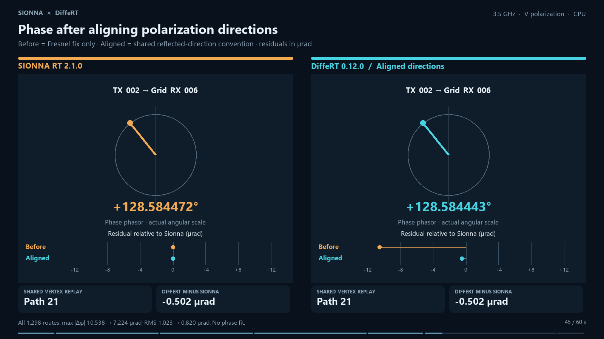](https://github.com/fribas001/differt-bridge/releases/download/project-2026-11-11/comparison_animation_aligned-Sionna_vs_DiffeRT_Overview.mp4)

[Watch/download MP4](https://github.com/fribas001/differt-bridge/releases/download/project-2026-11-11/comparison_animation_aligned-Sionna_vs_DiffeRT_Overview.mp4) · Offline report: `outputs/differt-bridge/examples/comparison_animation_aligned/index.html`

### Arithmetic implementation alignment

[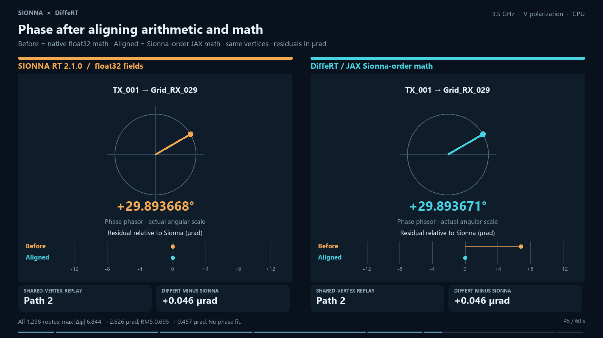](https://github.com/fribas001/differt-bridge/releases/download/project-2026-11-11/comparison_animation_arithmetic-Sionna_vs_DiffeRT_Overview.mp4)

[Watch/download MP4](https://github.com/fribas001/differt-bridge/releases/download/project-2026-11-11/comparison_animation_arithmetic-Sionna_vs_DiffeRT_Overview.mp4) · Offline report: `outputs/differt-bridge/examples/comparison_animation_arithmetic/index.html`

### Combined-field calculation alignment

[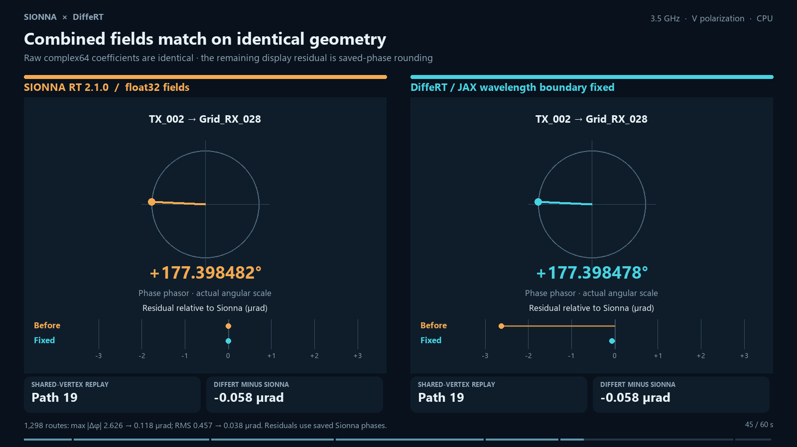](https://github.com/fribas001/differt-bridge/releases/download/project-2026-11-11/comparison_animation_combined_field-Sionna_vs_DiffeRT_Overview.mp4)

[Watch/download MP4](https://github.com/fribas001/differt-bridge/releases/download/project-2026-11-11/comparison_animation_combined_field-Sionna_vs_DiffeRT_Overview.mp4) · Offline report: `outputs/differt-bridge/examples/comparison_animation_combined_field/index.html`

### Common geometry and material inputs

[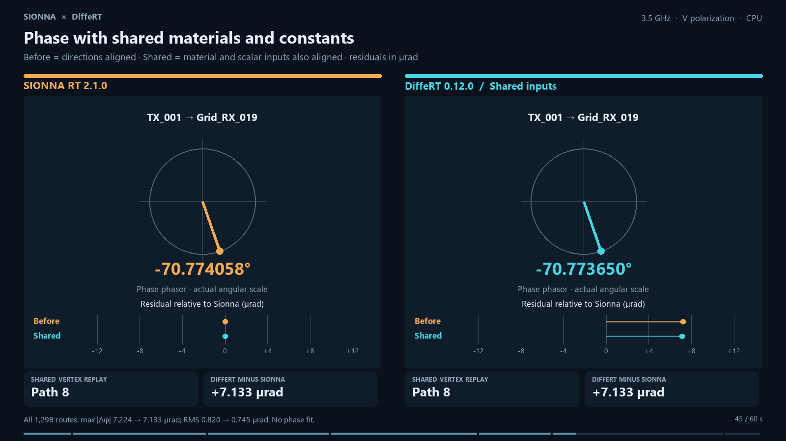](https://github.com/fribas001/differt-bridge/releases/download/project-2026-11-11/comparison_animation_common_inputs-Sionna_vs_DiffeRT_Overview.mp4)

[Watch/download MP4](https://github.com/fribas001/differt-bridge/releases/download/project-2026-11-11/comparison_animation_common_inputs-Sionna_vs_DiffeRT_Overview.mp4) · Offline report: `outputs/differt-bridge/examples/comparison_animation_common_inputs/index.html`

### Floating-point precision alignment

[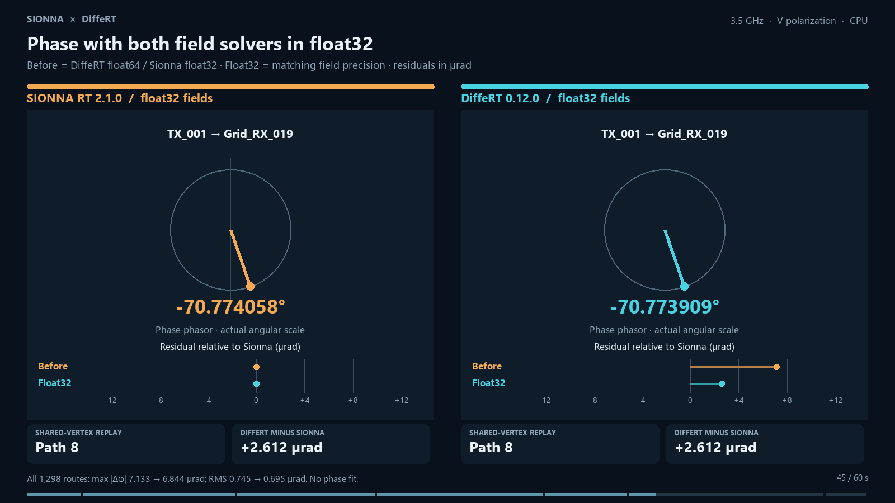](https://github.com/fribas001/differt-bridge/releases/download/project-2026-11-11/comparison_animation_float32-Sionna_vs_DiffeRT_Overview.mp4)

[Watch/download MP4](https://github.com/fribas001/differt-bridge/releases/download/project-2026-11-11/comparison_animation_float32-Sionna_vs_DiffeRT_Overview.mp4) · Offline report: `outputs/differt-bridge/examples/comparison_animation_float32/index.html`

### DiffeRT precision patch

[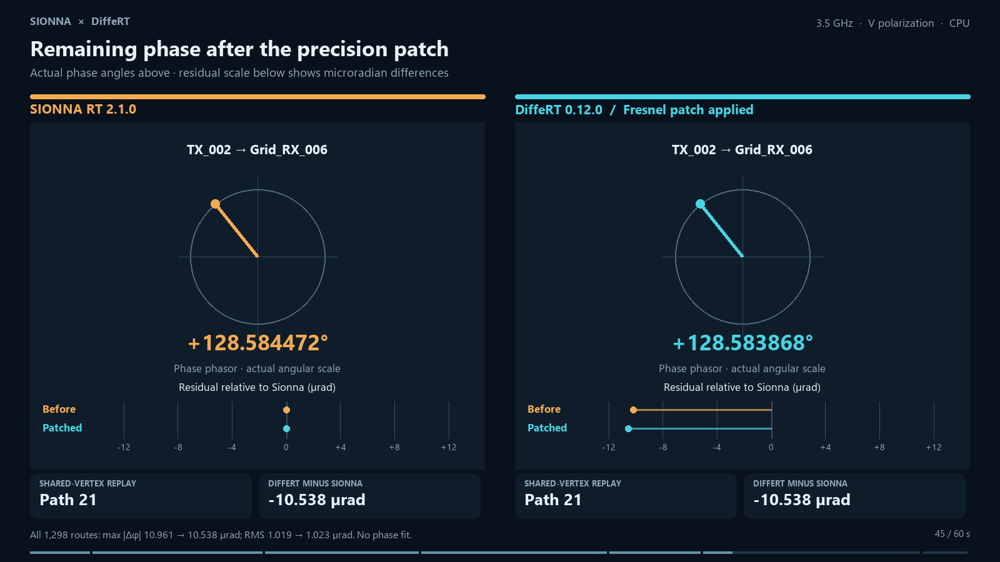](https://github.com/fribas001/differt-bridge/releases/download/project-2026-11-11/comparison_animation_patched-Sionna_vs_DiffeRT_Overview.mp4)

[Watch/download MP4](https://github.com/fribas001/differt-bridge/releases/download/project-2026-11-11/comparison_animation_patched-Sionna_vs_DiffeRT_Overview.mp4) · Offline report: `outputs/differt-bridge/examples/comparison_animation_patched/index.html`

### Phase-export rounding

[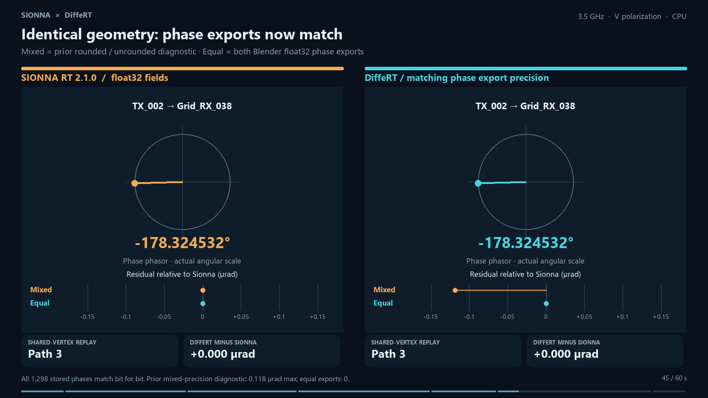](https://github.com/fribas001/differt-bridge/releases/download/project-2026-11-11/comparison_animation_phase_export-Sionna_vs_DiffeRT_Overview.mp4)

[Watch/download MP4](https://github.com/fribas001/differt-bridge/releases/download/project-2026-11-11/comparison_animation_phase_export-Sionna_vs_DiffeRT_Overview.mp4) · Offline report: `outputs/differt-bridge/examples/comparison_animation_phase_export/index.html`

### Native reflection-point reconstruction

[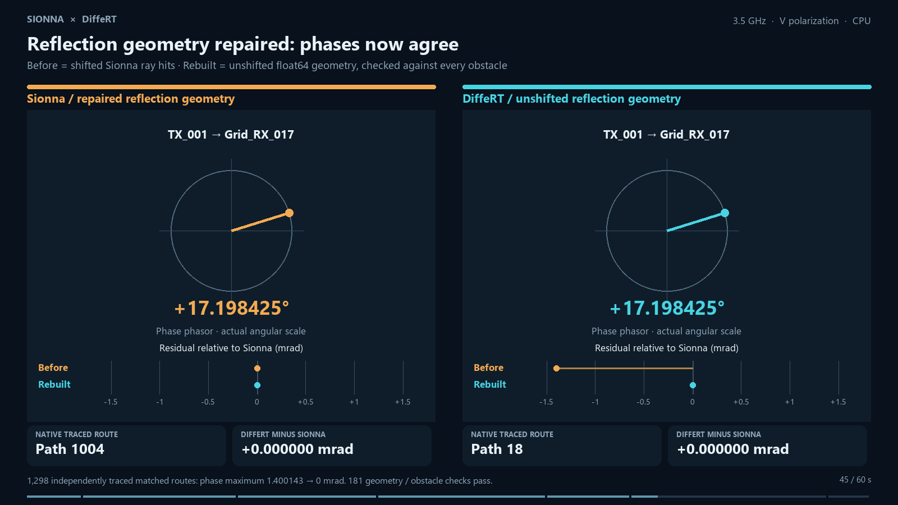](https://github.com/fribas001/differt-bridge/releases/download/project-2026-11-11/comparison_animation_reflection_geometry-Sionna_vs_DiffeRT_Overview.mp4)

[Watch/download MP4](https://github.com/fribas001/differt-bridge/releases/download/project-2026-11-11/comparison_animation_reflection_geometry-Sionna_vs_DiffeRT_Overview.mp4) · Offline report: `outputs/differt-bridge/examples/comparison_animation_reflection_geometry/index.html`

### Final specular phase and corner-path comparison

[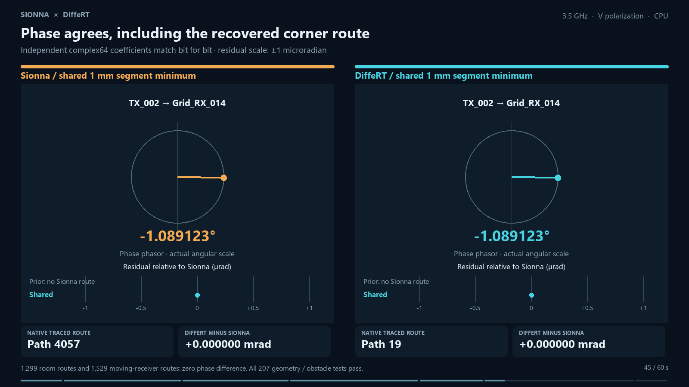](https://github.com/fribas001/differt-bridge/releases/download/project-2026-11-11/comparison_animation_segment_length-Sionna_vs_DiffeRT_Overview.mp4)

[Watch/download MP4](https://github.com/fribas001/differt-bridge/releases/download/project-2026-11-11/comparison_animation_segment_length-Sionna_vs_DiffeRT_Overview.mp4) · Offline report: `outputs/differt-bridge/examples/comparison_animation_segment_length/index.html`

### Native 3D dielectric diffraction

[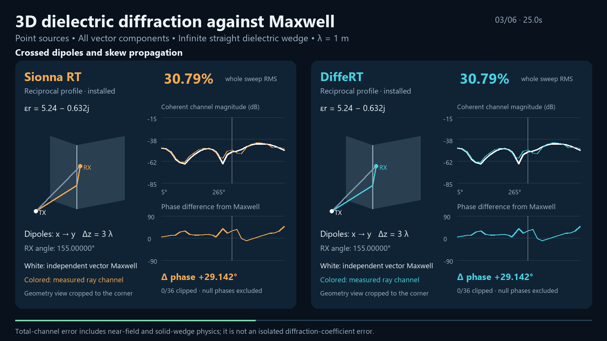](https://github.com/fribas001/differt-bridge/releases/download/project-2026-11-11/dielectric3d_diffraction-Sionna_vs_DiffeRT_Dielectric3D.mp4)

[Watch/download MP4](https://github.com/fribas001/differt-bridge/releases/download/project-2026-11-11/dielectric3d_diffraction-Sionna_vs_DiffeRT_Dielectric3D.mp4) · Offline report: `outputs/differt-bridge/examples/dielectric3d_diffraction/index.html`

### Polarization error and reference refinement

[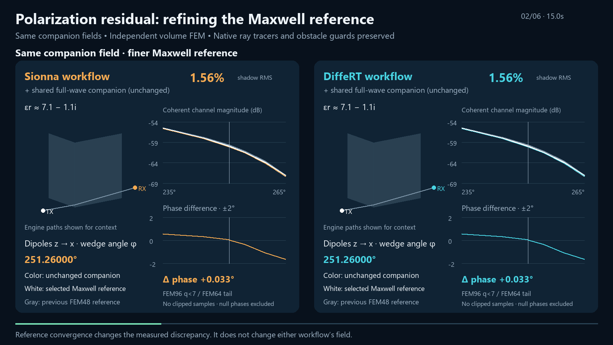](https://github.com/fribas001/differt-bridge/releases/download/project-2026-11-11/dielectric3d_polarization-Sionna_vs_DiffeRT_Polarization.mp4)

[Watch/download MP4](https://github.com/fribas001/differt-bridge/releases/download/project-2026-11-11/dielectric3d_polarization-Sionna_vs_DiffeRT_Polarization.mp4) · Offline report: `outputs/differt-bridge/examples/dielectric3d_polarization/index.html`

### 3D dielectric shadow-field refinement

[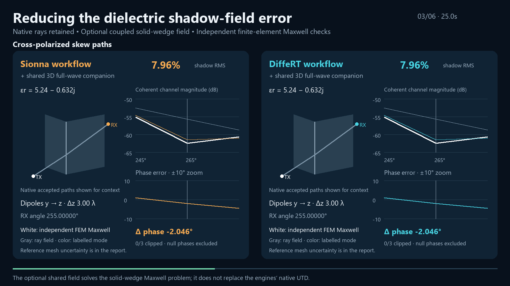](https://github.com/fribas001/differt-bridge/releases/download/project-2026-11-11/dielectric3d_refinement-Sionna_vs_DiffeRT_Dielectric3D_Refined.mp4)

[Watch/download MP4](https://github.com/fribas001/differt-bridge/releases/download/project-2026-11-11/dielectric3d_refinement-Sionna_vs_DiffeRT_Dielectric3D_Refined.mp4) · Offline report: `outputs/differt-bridge/examples/dielectric3d_refinement/index.html`

### Latest polarization residual and Maxwell reference

[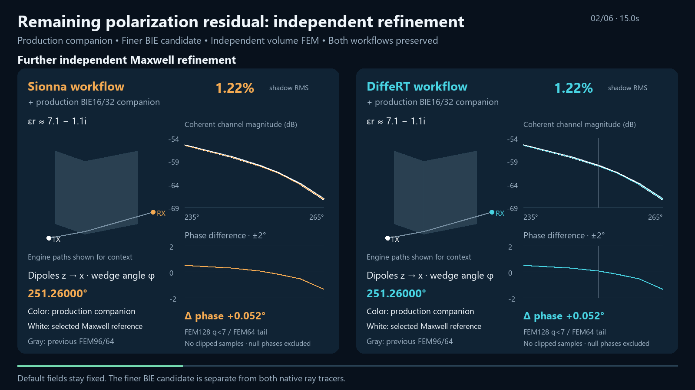](https://github.com/fribas001/differt-bridge/releases/download/project-2026-11-11/dielectric3d_residual-Sionna_vs_DiffeRT_Residual.mp4)

[Watch/download MP4](https://github.com/fribas001/differt-bridge/releases/download/project-2026-11-11/dielectric3d_residual-Sionna_vs_DiffeRT_Residual.mp4) · Offline report: `outputs/differt-bridge/examples/dielectric3d_residual/index.html`

### Weak-polarization convergence

[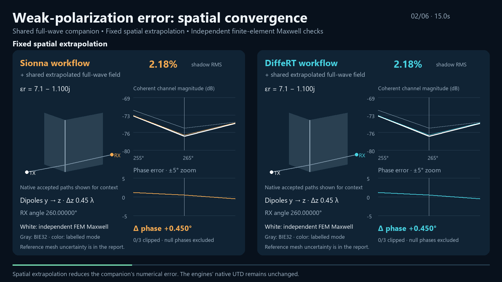](https://github.com/fribas001/differt-bridge/releases/download/project-2026-11-11/dielectric3d_weak-Sionna_vs_DiffeRT_Dielectric3D_Weak.mp4)

[Watch/download MP4](https://github.com/fribas001/differt-bridge/releases/download/project-2026-11-11/dielectric3d_weak-Sionna_vs_DiffeRT_Dielectric3D_Weak.mp4) · Offline report: `outputs/differt-bridge/examples/dielectric3d_weak/index.html`

### Diffraction features and stable native batches

[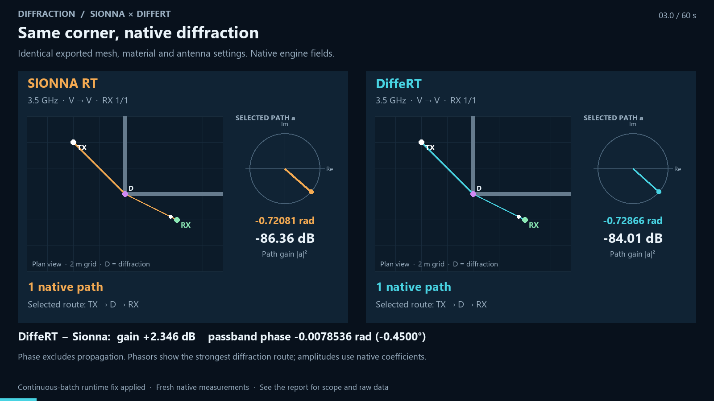](https://github.com/fribas001/differt-bridge/releases/download/project-2026-11-11/diffraction_batch-Sionna_vs_DiffeRT_Diffraction.mp4)

[Watch/download MP4](https://github.com/fribas001/differt-bridge/releases/download/project-2026-11-11/diffraction_batch-Sionna_vs_DiffeRT_Diffraction.mp4) · Offline report: `outputs/differt-bridge/examples/diffraction_batch/index.html`

### Native diffraction errors against Maxwell

[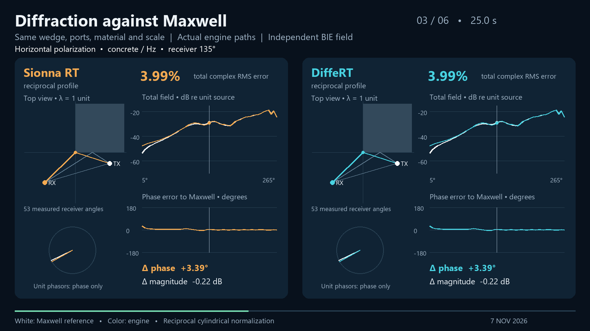](https://github.com/fribas001/differt-bridge/releases/download/project-2026-11-11/diffraction_model_errors-Sionna_vs_DiffeRT_Maxwell.mp4)

[Watch/download MP4](https://github.com/fribas001/differt-bridge/releases/download/project-2026-11-11/diffraction_model_errors-Sionna_vs_DiffeRT_Maxwell.mp4) · Offline report: `outputs/differt-bridge/examples/diffraction_model_errors/index.html`

### Optional 2D full-wave companion

[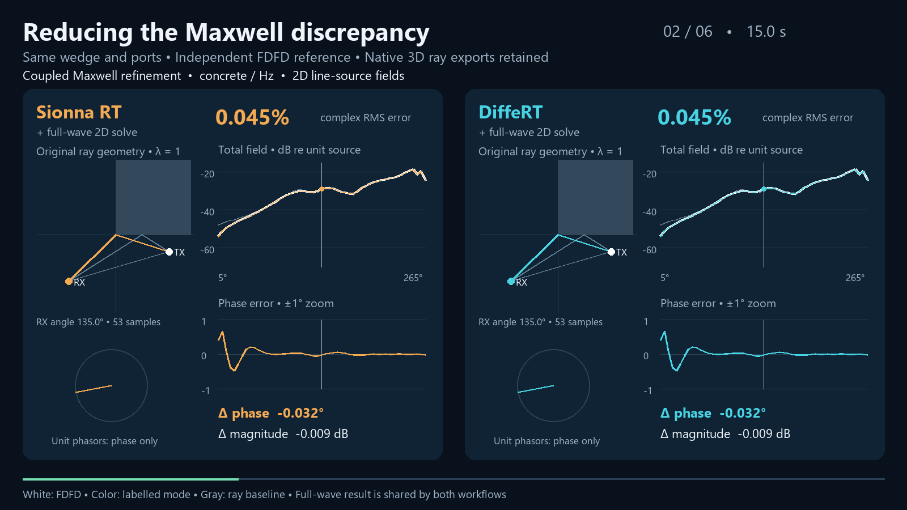](https://github.com/fribas001/differt-bridge/releases/download/project-2026-11-11/maxwell_refinement-Sionna_vs_DiffeRT_2D_Refinement.mp4)

[Watch/download MP4](https://github.com/fribas001/differt-bridge/releases/download/project-2026-11-11/maxwell_refinement-Sionna_vs_DiffeRT_2D_Refinement.mp4) · Offline report: `outputs/differt-bridge/examples/maxwell_refinement/index.html`

### Native 3D diffraction and PEC reference

[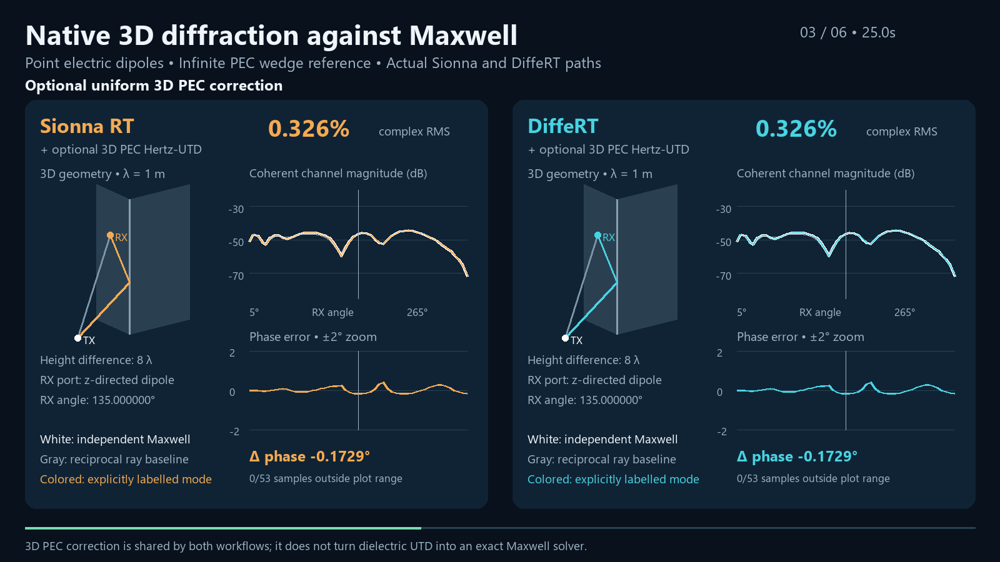](https://github.com/fribas001/differt-bridge/releases/download/project-2026-11-11/native3d_diffraction-Sionna_vs_DiffeRT_Native3D.mp4)

[Watch/download MP4](https://github.com/fribas001/differt-bridge/releases/download/project-2026-11-11/native3d_diffraction-Sionna_vs_DiffeRT_Native3D.mp4) · Offline report: `outputs/differt-bridge/examples/native3d_diffraction/index.html`

## Storage and scientific scope

The release preserves results and source rather than duplicating full working venvs or transient caches. Setup creates fresh venvs. Rendered frame sequences, cache directories, publishing credentials/tools and unrelated upstream checkouts are excluded; original videos, posters, input scenes, numerical arrays and reproduction source are retained. The selection audit records exclusions.

Uploading does not itself free local disk. Remove local copies only after their remote SHA-256 values and recovery checks have been verified. Keep active DiffeRT/Maxwell and shared RT 2.2 environments plus the scenes/results used by the current Blender workflow. An external copy is still useful for long-term backup.

The original four-runtime dispatcher draft is retained as historical development work. This release provides a tested recovery launcher and explicit study entry points; it does not advertise an unimplemented one-command rerun of every experiment.
